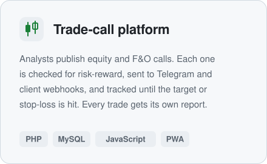
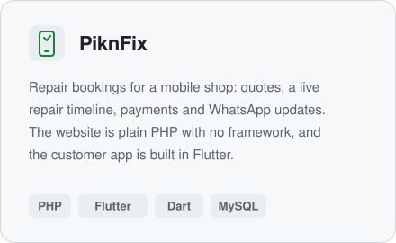
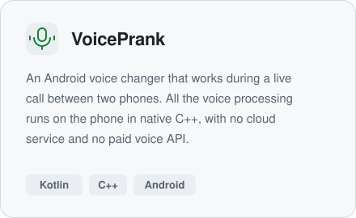
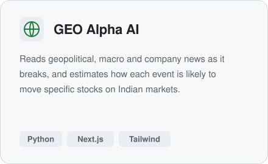
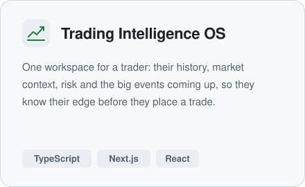

<picture>
  <source media="(prefers-color-scheme: dark)" srcset="assets/header-dark.svg">
  
</picture>

Hi, I'm Arijit. Most days I work on the software behind an equity research and trading desk: the tools analysts use to publish their calls, the pipes that bring in live market prices, and the CRM the sales team lives in.

Outside of that I run AJ Webcraft, a small web and app studio, and keep a few projects of my own going: Android and Flutter apps, a couple of trading tools, browser extensions and the odd Windows utility.

#### Some things I've built

<picture>
  <source media="(prefers-color-scheme: dark)" srcset="assets/trade-calls-dark.svg">
  
</picture>
<picture>
  <source media="(prefers-color-scheme: dark)" srcset="assets/sales-crm-dark.svg">
  
</picture>

<picture>
  <source media="(prefers-color-scheme: dark)" srcset="assets/piknfix-dark.svg">
  
</picture>
<picture>
  <source media="(prefers-color-scheme: dark)" srcset="assets/voiceprank-dark.svg">
  
</picture>

<picture>
  <source media="(prefers-color-scheme: dark)" srcset="assets/geo-alpha-dark.svg">
  
</picture>
<picture>
  <source media="(prefers-color-scheme: dark)" srcset="assets/trader-os-dark.svg">
  
</picture>

#### What I work with

<table>
  <tr>
    <td><b>Languages</b></td>
    <td>
      
      
      
      
      
      
      
      
    </td>
  </tr>
  <tr>
    <td><b>Frameworks</b></td>
    <td>
      
      
      
      
      
      
      
      
    </td>
  </tr>
  <tr>
    <td><b>Data and servers</b></td>
    <td>
      
      
      
      
      
      
    </td>
  </tr>
</table>

#### Say hello

&nbsp;&nbsp;

Icons by <a href="https://icons8.com">Icons8</a>
