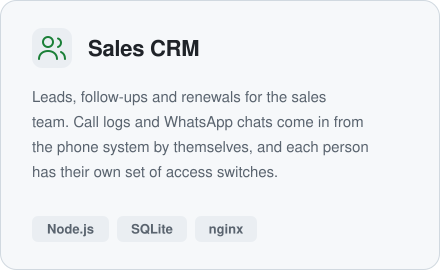

<picture>
  <source media="(prefers-color-scheme: dark)" srcset="assets/header-dark.svg">
  
</picture>

Hi, I'm Arijit. I work on the software behind an equity research and trading desk: the tools analysts use to publish their calls, the pipes that bring in live market prices, and lately the CRM the sales team lives in.

Nearly all of it is private company code, so here's a quick look at two of the bigger pieces instead.

<picture>
  <source media="(prefers-color-scheme: dark)" srcset="assets/trade-calls-dark.svg">
  
</picture>
<picture>
  <source media="(prefers-color-scheme: dark)" srcset="assets/sales-crm-dark.svg">
  
</picture>

#### What I use

<picture>
  <source media="(prefers-color-scheme: dark)" srcset="https://skillicons.dev/icons?i=php,js,ts,py,nodejs,mysql,sqlite,tailwind,docker,nginx,linux&theme=dark&perline=11">
  
</picture>

#### Say hello

&nbsp;&nbsp;&nbsp;&nbsp;
